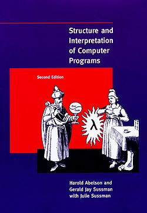

# "Structure and Interpretation of Computer Programs"



## Background
Going through the awesome [Teach Yourself Computer Science](https://teachyourselfcs.com/) website, I found out about the [SICP](https://sarabander.github.io/sicp/html/) book.

I had already seen it while browsing about functional programming, but this site definitely convinced me to give it a try.

## Objective 

This repository is meant to share my learning of SICP, along with useful resources I find along the way, for people who share my interests and want to learn SICP the hard way using good old [Scheme](https://www.scheme.org/) in the 2020s.

I'll try to play my part in the fabulous free learning brought by institutions such as MIT and UC Berkeley. I hope you'll enjoy it.

## Running the code

The `Dockerfile` provides Racket with the [`sicp`](https://docs.racket-lang.org/sicp-manual/index.html) and [`simply-scheme`](https://docs.racket-lang.org/manual@simply-scheme/index.html) languages. Start a file with `#lang sicp` to get the book's primitives (`nil`, `inc`, `dec`, `cons-stream`, `runtime`...).

```sh
docker build -t sicp .

# #lang sicp REPL
docker run -it --rm -v "$PWD":/home/schemeuser/sicp sicp

# Run a file
docker run -it --rm -v "$PWD":/home/schemeuser/sicp sicp racket sicp/book/chapter_1/chapter_1_exercises.rkt
```

Some exercises (e.g. 1.5) loop forever on purpose: stop them with `Ctrl-C`.

## Awesome SICP list
- [SICP online](https://sarabander.github.io/sicp/html/): the full book in HTML.
- [MIT 6.001 lectures (1986)](https://www.youtube.com/playlist?list=PLE18841CABEA24090): the original video lectures by Abelson and Sussman.
- [MIT OpenCourseWare 6.001](https://ocw.mit.edu/courses/6-001-structure-and-interpretation-of-computer-programs-spring-2005/): course notes and projects.
- [SICP language for Racket](https://docs.racket-lang.org/sicp-manual/index.html): documentation of `#lang sicp`.
- [SICP Solutions](http://community.schemewiki.org/?SICP-Solutions): community-annotated solutions to the exercises.
- [SICP in Guile & Emacs Lisp](https://github.com/zv/SICP-guile): solutions in Guile.


---

Gabriel LOPEZ

01/25/2025
